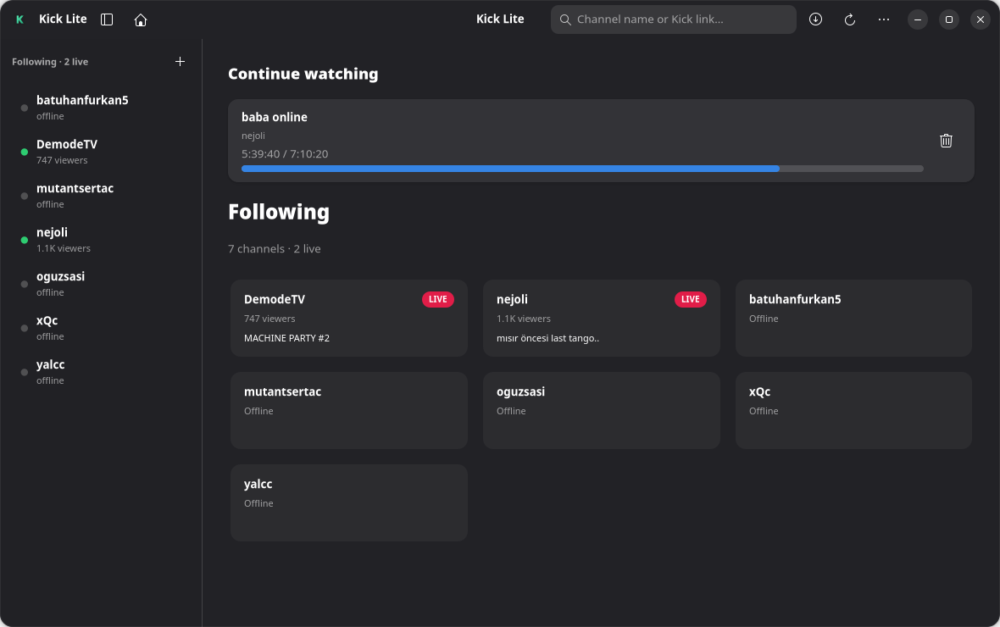
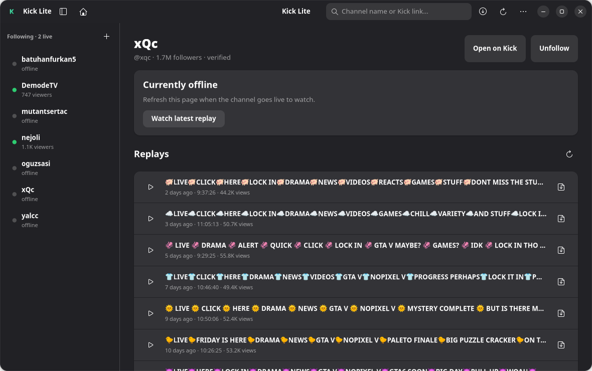
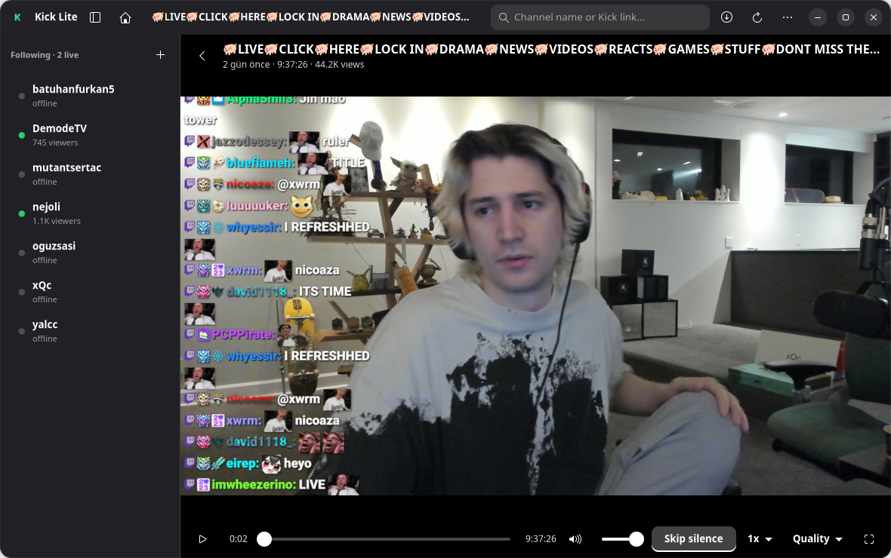

# Kick Lite

A lightweight desktop client written in Rust for Linux, for watching Kick.com livestreams and replays. It does not embed a web browser; it uses GTK4, libadwaita and libmpv.

## Screenshots

Home — followed channels, live status and continue watching:

<a href="docs/home.png"></a>

Channel — live status, follow button and replays:

<a href="docs/channel.png"></a>

Player — video playback with quality, speed and silence controls:

<a href="docs/player.png"></a>

## Features

- Open by Kick channel name, channel URL, or VOD URL
- Play livestreams and VODs
- Multi-view: open up to four additional livestreams in mini players while one
  stream plays in the main view; click a mini player to swap it into the main
  view (the previous stream moves back into a mini player). Mini players start
  muted and can be unmuted individually; they can be closed one by one or all
  at once from the menu.
- HLS quality selection
- Download replays in the quality of your choice and watch them later offline
  (stored under `~/.local/share/kick-lite/downloads`, listed on the home page)
- Play/pause, seeking, volume and fullscreen controls
- Skip silent parts in replays (VOD), can be toggled on/off
- Silence threshold (dB) and minimum silence duration adjustable from the menu
- Store followed channels in `~/.config/kick-lite/config.json`
- Wayland and X11 support
- Does not load visual thumbnails or chat; keeps memory usage low

## Requirements

On Arch/CachyOS:

```bash
sudo pacman -S --needed rust gtk4 libadwaita mpv libepoxy
```

Package names may differ on your distribution. When building, the development files for GTK4, libadwaita, libmpv and OpenGL/EGL must be discoverable through `pkg-config`.

## Building and running

```bash
cargo build --release
./target/release/kick-lite
./target/release/kick-lite xqc
./target/release/kick-lite 'https://kick.com/xqc?video=VOD_ID'
```

The application uses Kick's public, unofficial API endpoints. If Kick's API or Cloudflare policy changes, channel/VOD information may no longer be retrievable. Since there is no public, stable API for the live channel list, channels must be opened by name.

## Shortcuts

| Shortcut | Action |
| --- | --- |
| `Space` | Play / pause |
| `M` | Mute / unmute |
| `F` | Fullscreen |
| `Esc` | Back from player / exit fullscreen |
| `←` / `→` | Seek 5 seconds backward / forward |

To add a stream to multi-view, use the **+** button on a live channel card on the
home page, or **Open in mini player** on a channel page. Click a mini player to
make it the focused stream.

## Installation

To install for the local user:

```bash
./install.sh
```

This copies the binary to `~/.local/bin`, the desktop file to `~/.local/share/applications`, and the icon to `~/.local/share/icons/hicolor/scalable/apps`.

## License

MIT
